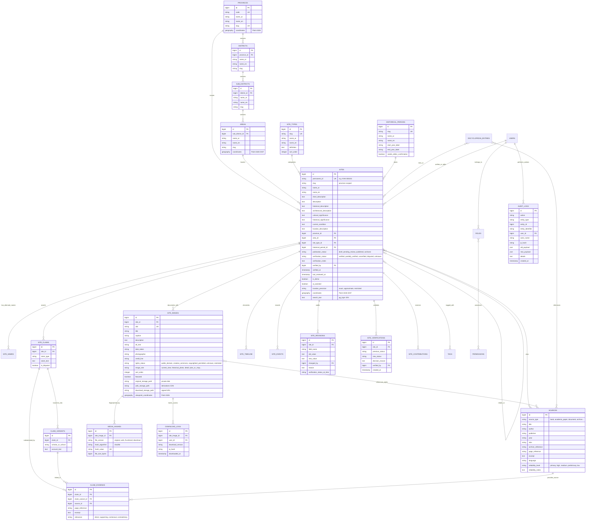

# Entity Relationship Diagram (ERD) — «أثر كربلاء»
### Karbala Heritage Archive Database Schema

This document details the relational data model for **«أثر كربلاء» (Karbala Heritage Archive)**, designed in accordance with Prompt 2.

---

---

## 🔐 Key Data Architecture Invariants

1. **Geometry & Location Precision**:
   - The PostGIS `coordinates geography(Point, 4326)` column with a `GIST` index is the only coordinate source.
   - `latitude` and `longitude` are strictly derived accessors.
   - For records where `location_precision = 'restricted'`, exact coordinates are fuzzed and masked at the model level before leaving the backend to prevent archaeological looting.

2. **Arabic Full-Text Normalization**:
   - `search_text` is maintained by `SiteObserver` on saving.
   - It strips tashkeel, tatweel, and unifies alef/yaa/taa marbuta variants.
   - Indexed via `pg_trgm gin_trgm_ops` for fuzzy, diacritic-tolerant substring matching.

3. **Separation of Concerns**:
   - `publication_status` is independent from `verification_status`. A published record is never assumed to be verified.
   - Every substantive edit triggers a verification status review and logs an append-only revision.
